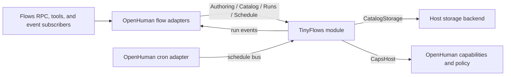

# Flows on TinyFlows

OpenHuman's flows domain owns the product surface for saved automations: RPC and
agent tools, trigger subscriptions, host policy, and the callbacks that connect
workflow nodes to OpenHuman services. The TinyFlows module owns the portable
workflow engine, Catalog and Runs behavior, schedule service, and Copilot
prompts. OpenHuman communicates with the module through `tinyflows-bus`; it does
not run a copy of the workflow engine inside the core.

This page describes the composition boundary. The [Agent harness](agent-harness.md)
page covers how an OpenHuman agent turn runs when a workflow `agent` node calls
the host's agent capability.

## Components and ownership

| Component | Responsibility |
| --- | --- |
| `tinyflows-module` | Workflow graph validation and execution, Catalog and Runs operations, scheduling, and authoring prompts. |
| `tinyflows-bus` | Synchronous method names, request/response DTOs, graph JSON, and callback contracts. |
| `openhuman::flows` | Workflow RPC and tools, event-to-run dispatch, host policy, and typed bus adapters. |
| `CatalogStorage` callback | Gives Catalog access to the current workspace backend under the captured storage scope. |
| `CapsHost` callback | Connects workflow capabilities to OpenHuman inference, agents, tools, HTTP, code, and memory. |
| `openhuman::cron` | Submits and removes schedule jobs; the TinyFlows schedule service fires them through the host trigger sink. |

The bus contracts describe wire data and callback shapes. Module implementation
and product policy stay with their respective owners: graph rules and execution
belong to TinyFlows, while OpenHuman owns acting scope, approvals, sandboxing,
Composio access, and host tool dispatch.

## Authoring and safe saves

Graphs cross the host boundary as JSON. OpenHuman calls TinyFlows Authoring
members for migration, validation, graph compatibility, import normalization,
and builder failures. The module supplies the normalized graph to scoped host
gates for OpenHuman-specific checks, such as whether an agent reference
resolves, a Composio connection belongs to the selected toolkit, a native
upload path stays in the workspace, and required tool arguments are present.

Catalog owns save semantics. Its `PutWorkflow` operation decides whether an
automatic workflow must start disabled, whether side-effecting workflows need
approval, and whether an update that changes a manual trigger to an automatic
trigger should disarm the workflow. Keep those decisions in the module and pass
host-specific classification or identity through its callbacks.

The flows tools and the canvas both call these same module operations. Draft
promotion uses the Catalog path as well, so it inherits the same checks and
write behavior. Each accepted update is projected to OpenHuman's existing RPC
and event contracts.

## Run lifecycle

A run begins through Runs.StartRun. OpenHuman supplies the trusted run origin,
acting storage scope, and callback addresses; the TinyFlows module owns the run
state, checkpoints, admission, execution, cancellation, and resume rules.
OpenHuman polls the module's run events and maps them to the established RPC,
progress, approval, and Langfuse surfaces.

`runs_adapter::RunBindings` retains the scope-bound CatalogStorage and per-run
CapsHost registrations until polling reports terminal settlement. Approval-
parked runs keep those callbacks alive. Resume creates a fresh CapsHost
registration while keeping the same stable CatalogStorage address.

When a workflow has an agent node, the module calls OpenHuman's agent capability.
The host resolves the configured agent and invokes the same Agent runtime used by
other product surfaces. The flow's trusted origin, autonomy tier, approval
policy, and the agent's own tool scope and sandbox remain OpenHuman decisions.

Automatic triggers use the same Runs path. OpenHuman binds and removes
`JobType::Flow` entries through the Schedule bus contract; cron supplies the
trigger payload back to the flow subscriber. Composio triggers follow the
existing integration event path. A trigger selects a run request; it does not
create a second execution engine.

## Storage migration

Catalog and Schedule own their storage schemas. At boot, OpenHuman runs both
owners' migration operations for every discovered storage scope before flow
recovery, schedule reconciliation, or TTL cleanup. These operations run before
optional host services start, so a Catalog migration failure is reported for
the flow domain without blocking chat, login, or unrelated storage scopes.

Legacy TinyFlows files are read by the pure readers in `tinyflows-import` and
replayed through Catalog.ImportLegacyBatch. The files are not opened for
writing or removed. OpenHuman records an import marker only after every reader
and owner batch succeeds cleanly. A failed or incomplete local import pauses
workflow access for that scope and retries at the next boot; other core domains
continue. An unbooted local-storage fallback migrates Catalog's schema on first
use and deliberately does not import legacy files.

## Security boundary

`flows_run` and `flows_resume` establish the trusted automation origin before
calling Runs. The Capsule callbacks apply OpenHuman's autonomy policy before a
node can use native tools, Composio, HTTP, code, or memory. Native flow tools use
the same native-tool registry as other OpenHuman surfaces, with the flow-specific
approval context attached by CapsHost. Agent nodes also run under the flow
origin, then apply the selected agent's ToolScope, sandbox, and iteration cap.

This keeps engine execution generic while preserving host guarantees. A module
node cannot choose a different workspace, storage scope, or security policy by
changing graph data.

## Where to look

- `crates/openhuman-core/src/flows/ops/` contains host operations and the bus
  calls they compose.
- `crates/openhuman-core/src/flows/host_gates/` contains OpenHuman authoring
  gates over normalized graph JSON.
- `crates/openhuman-core/src/flows/catalog_storage.rs` serves the scope-bound
  CatalogStorage callback.
- `crates/openhuman-core/src/flows/caps_host/` serves the per-run capabilities
  and tool dispatch.
- `crates/openhuman-core/src/flows/runs_adapter/` owns run callback lifetime,
  polling, and RPC projection.
- `crates/openhuman-core/src/storage/import/tinyflows.rs` sequences owner
  migrations and bounded legacy readers.
- `vendor/tinyflows/crates/tinyflows-bus/` defines the contracts; the engine and
  module implementation live in the TinyFlows repository.

See the [Flows domain README](../../../../../crates/openhuman-core/src/flows/README.md)
for RPC names, authoring gates, and module integration tests.
